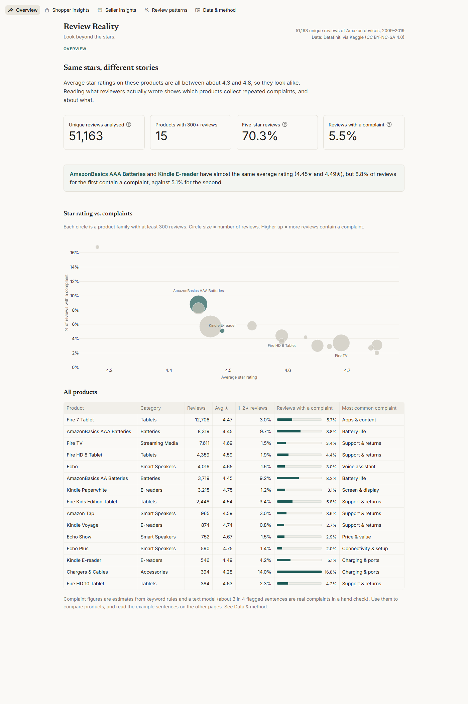
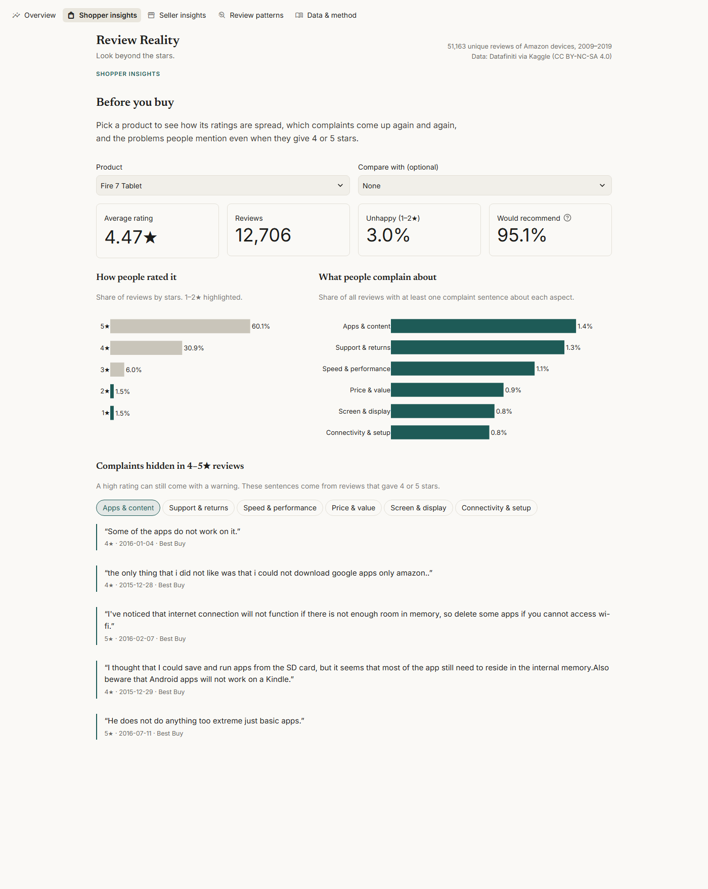
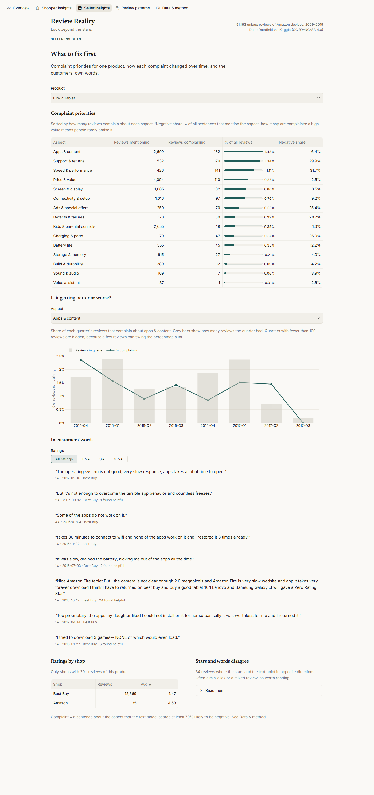
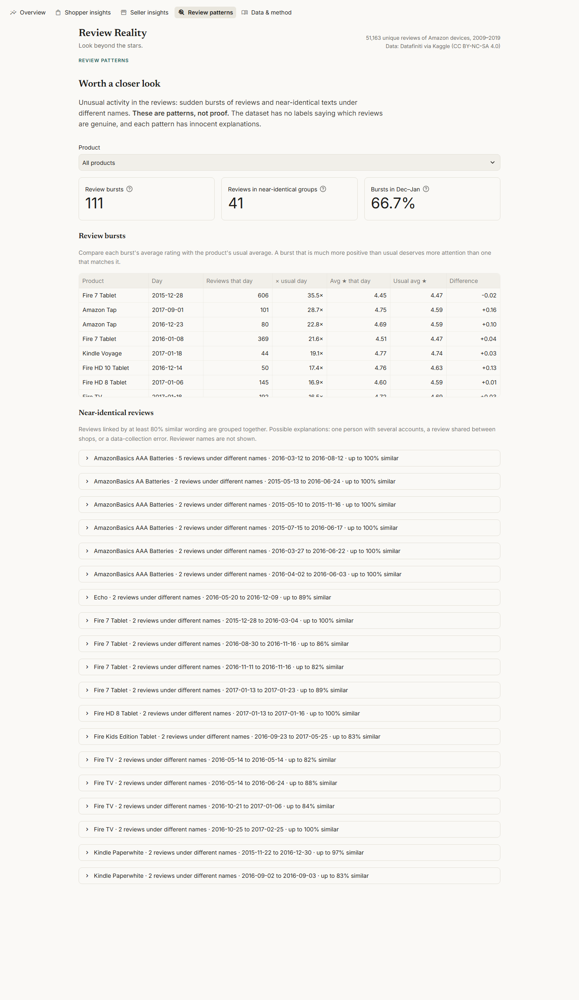
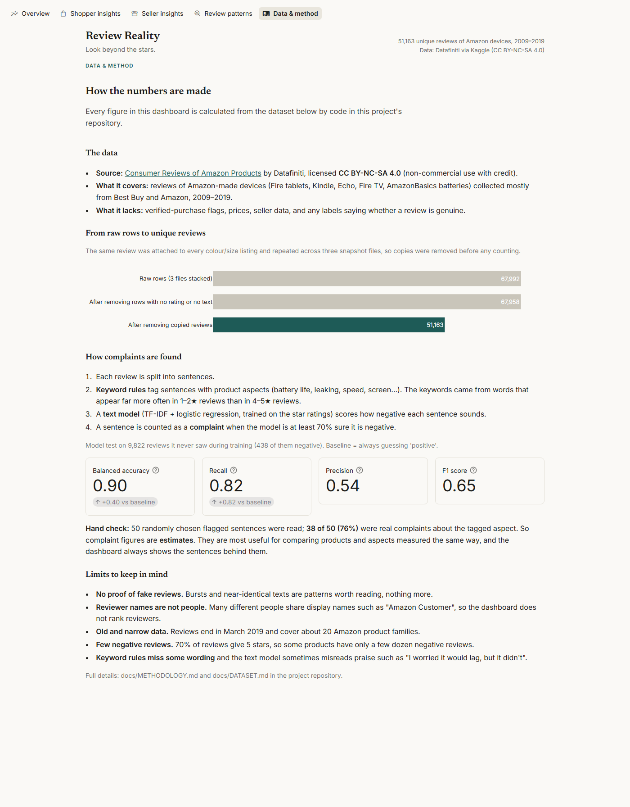

# Review Reality

**Look beyond the stars.**

Review Reality is a review analytics dashboard. It reads 51,163 product reviews to show what an average star rating hides:

- **Shoppers** see how ratings are spread, which complaints keep coming back, and the warnings people write even in 4–5★ reviews.
- **Sellers** see which problems to fix first, whether each problem is growing or shrinking, and the customers' own words.
- **Everyone** sees unusual review activity (bursts, copied text) clearly labelled as *patterns worth checking*, never as proof of fake reviews.

Built with Python, pandas, SQLite/SQL, scikit-learn, Streamlit and Plotly. Everything is free and runs locally.



## Key findings

All numbers are calculated by the code in this repository (see [docs/ANALYSIS_RESULTS.md](docs/ANALYSIS_RESULTS.md)). Complaint figures are estimates; see [How much to trust the numbers](#how-much-to-trust-the-numbers).

1. **Raw data overcounts.** The same review was attached to every colour and size of a product and repeated across three snapshot files. 67,992 raw rows contain only **51,163 unique reviews** (25% were copies).
2. **Averages are crowded at the top.** 70.3% of reviews give 5 stars, and the 15 products with 300+ reviews average between 4.28★ and 4.75★.
3. **Same stars, different stories.** AmazonBasics AAA Batteries (4.45★) and the Kindle E-reader (4.49★) look alike, but **8.8%** of battery reviews contain a complaint, against **5.1%** for the Kindle.
4. **Battery life is the battery's weak spot.** 5.3% of all AAA-battery reviews complain about battery life, and 67.5% of sentences that mention battery life are negative. 77 reviews complain about **leaking**.
5. **Hidden complaints in good reviews.** The Fire 7 Tablet's most common complaint is apps and content. Several come from 4–5★ reviews, for example not being able to install Google Play apps.
6. **Review bursts look like gift season, not rating inflation.** 111 days had 5+ times a product's usual number of reviews. Two-thirds fall in December–January, and every burst's average rating is within 0.28 stars of the product's usual average.
7. **Copy-paste reviews are rare.** Only 41 reviews (19 groups) are near-identical texts under different names. The largest is one AAA-battery review posted under 5 names between March and August 2016.

## Screenshots

| Shopper insights | Seller insights |
|---|---|
|  |  |
| **Review patterns** | **Data & method** |
|  |  |

## Dashboard pages

| Page | What it answers |
|---|---|
| **Overview** | Which products have similar stars but very different complaint levels? |
| **Shopper insights** | For one product (or two side by side): how ratings are spread, the most common complaints, and complaints hidden inside 4–5★ reviews. |
| **Seller insights** | Complaint priorities, whether each complaint is rising or falling by quarter, customers' own words, ratings by shop, and reviews whose stars and words disagree. |
| **Review patterns** | Review bursts compared with the product's usual rating, and groups of near-identical reviews under different names. |
| **Data & method** | Source, licence, cleaning funnel, model test scores, hand-check result and limitations. |

## How it works

```
3 Kaggle CSV files ──► load.py ──► clean.py ──────────► SQLite (reviews.db) ──► sql/*.sql ──► Streamlit dashboard
 (67,992 rows)        rename      fix types,            products + reviews        12 queries     5 pages
                      columns     group listings into   + analytics tables
                                  product families,
                                  remove copies,
                                  anonymise names
                                         │
                                         ▼
                                  analytics.py: split into sentences → keyword rules tag aspects
                                  → text model scores how negative each sentence is
                                  → similar-review search, star/text mismatches
```

1. **Cleaning** (`review_reality/clean.py`): fills missing product names, groups 111 product listings into 20 product families, converts values safely, removes copied reviews, and replaces usernames with anonymous IDs.
2. **SQL** (`sql/`): one file per question. Uses JOINs, GROUP BY, CASE, CTEs, window functions (`ROW_NUMBER`, `AVG() OVER`), LEFT JOINs and parameters.
3. **Aspects** (`review_reality/aspects.py`): keyword rules for 17 aspects (battery life, leaking, speed, screen, ads, …). The keywords came from words that appear far more often in 1–2★ than in 4–5★ reviews.
4. **Text model** (`review_reality/sentiment.py`): TF-IDF + logistic regression trained on the star ratings. It scores single sentences, so it can find complaints inside positive reviews.
5. **Patterns** (`review_reality/analytics.py`, `sql/review_bursts.sql`): TF-IDF cosine similarity for near-identical texts; a window function for review bursts.

Full explanation: [docs/METHODOLOGY.md](docs/METHODOLOGY.md).

## How much to trust the numbers

| Check | Result |
|---|---|
| Text model on 9,822 held-out reviews | Balanced accuracy **0.895** (baseline 0.5), recall 0.82, precision 0.54 |
| Hand check of 50 random flagged complaint sentences | **38 of 50 (76%)** were real complaints about the tagged aspect |
| SQL vs an independent pandas calculation on the real database | Identical (automated test) |
| Automated tests | **68 passing**, including headless runs of every dashboard page and product |

What the data **cannot** tell us: whether any review is fake (there are no labels), whether a reviewer really bought the product (no verified-purchase flag), or anything about today's products (reviews end in March 2019). Reviewer display names are shared by many people ("Amazon Customer"), so the project does not rank reviewers.

## Run it yourself (Windows)

1. Download the dataset (free Kaggle account): see [docs/DATASET.md](docs/DATASET.md). Unzip it into `data/raw/datafiniti/`.
2. Then run:

```powershell
cd "$HOME\Desktop\Review-Reality"
py -m venv .venv                            # make the virtual environment (only once)
.venv\Scripts\Activate.ps1                  # turn it on (each new terminal)
python -m pip install -r requirements.txt   # install the libraries (only once)
python -m review_reality.build              # clean, analyse, build data/processed/reviews.db (about 2 min)
python -m pytest                            # run the tests
streamlit run app.py                        # open the dashboard at http://localhost:8501
```

If PowerShell blocks `Activate.ps1`, run this once: `Set-ExecutionPolicy -Scope CurrentUser RemoteSigned`

## Project structure

```
Review-Reality/
├── app.py               Dashboard entry point (streamlit run app.py)
├── dashboard/           One file per page, plus data.py (cached SQL) and style.py (look and feel)
├── review_reality/      Data pipeline and analysis
│   ├── paths.py         All file locations
│   ├── load.py          Read the raw CSVs, rename columns
│   ├── products.py      Group listings into product families
│   ├── clean.py         Fix types, remove unusable rows and copies, anonymise reviewers
│   ├── db.py            Save to SQLite, run SQL files
│   ├── aspects.py       Keyword rules: which aspect a sentence talks about
│   ├── sentiment.py     Text model: how negative a sentence sounds
│   ├── analytics.py     Aspect complaints, out-of-fold review scores, similar reviews
│   ├── insights.py      Turns calculated tables into short findings
│   └── build.py         Runs everything: python -m review_reality.build
├── sql/                 12 SQL queries, one per question
├── tests/               68 pytest tests
├── docs/                Dataset, methodology, generated results, screenshots, interview notes
├── .streamlit/          Theme and settings (usage statistics switched off)
├── data/                Raw and processed data. NOT in Git
├── requirements.txt     Exact library versions (tested on Python 3.15.1)
└── pyproject.toml       Project settings
```

## Data source and licence

[Consumer Reviews of Amazon Products](https://www.kaggle.com/datasets/datafiniti/consumer-reviews-of-amazon-products) by **Datafiniti**, licensed **CC BY-NC-SA 4.0**. Reviews of Amazon-made devices (Fire tablets, Kindle, Echo, Fire TV, AmazonBasics batteries), collected mostly from Best Buy and Amazon, 2009–2019. The raw data is not included in this repository. Screenshots contain short review excerpts from this dataset, shared under the same licence with credit to Datafiniti.

## Future improvements

- Replace keyword rules with a model trained on a small hand-labelled set of aspect sentences, and measure the gain.
- Handle negation ("it didn't lag") explicitly before scoring sentences.
- Add a newer dataset to see whether the same complaints persist in later product generations.

## Progress

- [x] Phase 1: Environment and project setup
- [x] Phase 2: Choose and understand the dataset
- [x] Phase 3: Data cleaning and SQL
- [x] Phase 4: Exploratory data analysis
- [x] Phase 5: Core analytics
- [x] Phase 6: Dashboard
- [x] Phase 7: Testing and quality checks
- [x] Phase 8: Documentation and interview preparation ([docs/INTERVIEW_PREP.md](docs/INTERVIEW_PREP.md))
